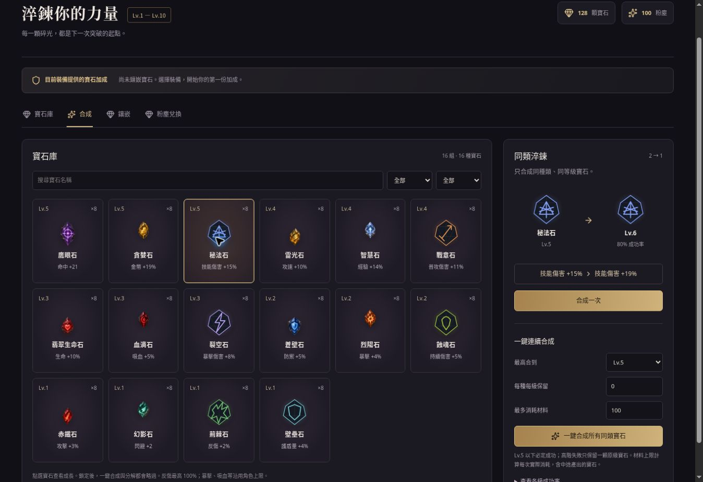

# 寶石 Lv.1～Lv.10（2026-10-26）

數值權威：`balanceConfig.gems.values`。十種原寶石加上荊棘石（反傷）、蝕魂石（持續傷害）、裂空石（暴擊傷害）、戰意石（普攻傷害）、秘法石（技能傷害）、壁壘石（護盾量），共16種。

## 等級與相容

- 存檔 schema 仍為7；舊 `beginner/intermediate/advanced` 分別就是 Lv.1/2/3，數值完整保留。不重新抽選、不降級、不清空庫存與鑲嵌。
- Lv.4～10 使用 `lv4`～`lv10`；庫存最多160組。鎖定以 stack 的 `locked` 保存，對整組同種同級寶石生效。
- 原有掉落地圖門檻與機率維持，種類池擴充至16種；Lv.4以上來自伺服器合成。離線掉落共用同一池。沒有更動每日重置、輪迴條件或原本寶石是否保留的規則。
- 新增 `gemPowder` 預設0、`_gemRevision` 預設0、伺服器專用 `_gemActionIds` 最近256筆。正常舊存檔不需 SQL migration。

## 合成

- 僅同種類、同等級二合一；不同寶石混合合成已取消。
- 目標 Lv.2～5 成功率100%；Lv.6/7/8/9/10 為80/65/50/35/25%。
- 成功消耗兩顆，產出一顆下一級；失敗消耗一顆，保留一顆原級寶石，無降級。
- 一鍵合成由低等級往高等級、依固定種類順序執行，直到材料不足、達目標或預算不足。預設最高Lv.5、每種每級保留0顆、最多消耗100顆，最大材料上限10000顆。鎖定組完全排除。材料預算含中途產物的再次投入，失敗按實際消耗1顆計數；剩餘預算不足2顆時不再嘗試。
- 單次合成只處理選定種類及來源等級，避免先消耗低階庫存。
- 高階結果不可預測，操作前顯示種類、目標、保留與消耗上限；結束統一回報成功、失敗與實際消耗。

## 鑲嵌、轉移與粉塵

- 每件仍最多兩孔，同件禁止重複種類。
- 原位升級投入背包1顆同種同級寶石，加上裝備原寶石組成兩顆；失敗保留裝備上的原寶石，只消耗背包材料。鎖定材料不參與。
- 可免費轉移至另一件有空孔且沒有同種寶石的裝備；來源清空與目的寫入在同一交易內完成。
- 分解在獨立分頁以「點擊累加」選取：每點一下一組寶石就增加分解1顆，可跨種類與等級選取，鎖定組會略過；單次提交以一筆伺服器交易驗證並結算全部數量（總量上限10,000顆）。分解Lv.N得到 `2^(N-1)` 粉塵；4粉塵兌換指定種類Lv.1一顆。分解不可逆，需確認，且不產生材料套利。

## 戰鬥分組

- 加成作用於穿戴中的角色，同類寶石相加，不逐顆連乘。攻防生命百分比沿用角色加成池；命中、閃避仍為評等，其餘寶石為百分比。暴擊、吸血等沿用既有上限。
- 荊棘：減傷後、護盾吸收前傷害×總反傷比例（最高100%）。閃避、格擋及DOT不反傷；不暴擊、不吸血、不再觸發攻擊被動或遞迴反傷。推圖／真實／個人／世界首領共用既有HP結算與跳字，世界王原固定攻擊與限時處刑不變。
- 蝕魂：只強化流血、灼燒跳傷，不強化冰凍爆炸、回響、控制時間、異常機率或層數。施加時保存加成快照；已施加DOT不因換裝改變，換怪清除。
- 戰意：只放大普攻本體，不放大神話獨立追擊、異常或套裝追加。
- 秘法、裂空：加入既有技能傷害／暴擊傷害欄位，沿用一般增傷與暴擊規則。
- 壁壘：僅放大新生成的魔力護盾及星界護體盾量，不改生命觸發門檻、不追溯放大現有盾，也不改最大生命爆炸基數。

## 同步與權威

- `/api/save` 的 `gem` 動作由伺服器抽取每次成功與否，驗證材料、種類、孔位、粉塵與操作ID，再以session＋版本條件原子寫入。一般存檔不得自己產生Lv.4以上寶石、鑲嵌變動、粉塵或交易回條。
- 操作前先同步當前掉落／新裝備，再暫停普通整包存檔；寶石、洗鍊、技能、商城及離線領取互斥。等待過程仍可戰鬥。
- 回應只套用交易相對於送出前雲端庫存的差量，保留請求期間的新掉落；裝備只更新孔位，不覆寫強化或背包。
- 連線未知保留原ID與原庫存基準，暫停後續整包上傳；重試不先上傳舊庫存，避免還原已消耗材料。重複回條不重抽、不重扣。重讀存檔／換session使舊回應失效。
- 普通存檔以 `_gemRevision` 保護舊快照；伺服器保存粉塵、孔內寶石與回條。原每日獎勵與離線領取保護不變。

測試：`gem-upgrade.test.mjs`、`gem-combat.test.mjs`、`gem-client-sync.test.mjs`，以及原有存檔、每日／離線、技能、套裝、首領與真實模式回歸。UI使用隔離記憶體測試資料，不接正式帳號。

新增寶石的普攻／持續傷害／反傷／護盾機制由現有固定亂數的成對訓練抽樣納入綜合戰力，與職業神話共用有界快取；零加成時保留原評分。這是裝備比較估計，不是實戰DPS保證。

新版桌機UI（隔離測試資料）：

